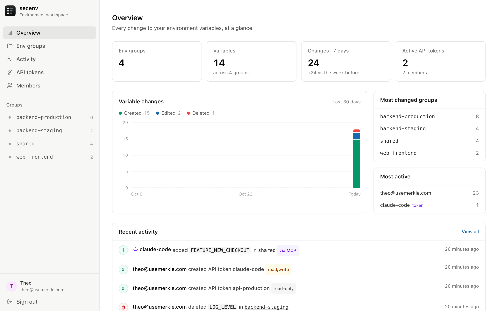
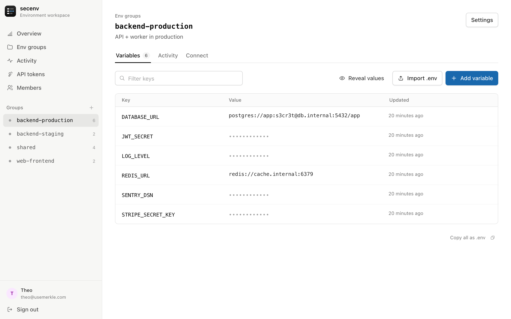
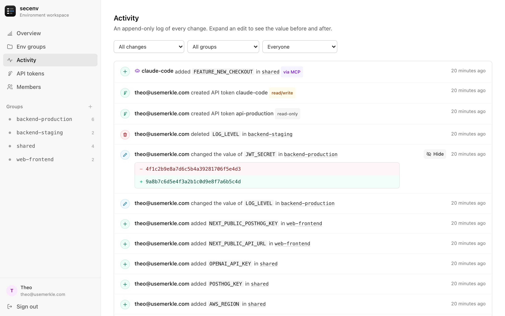
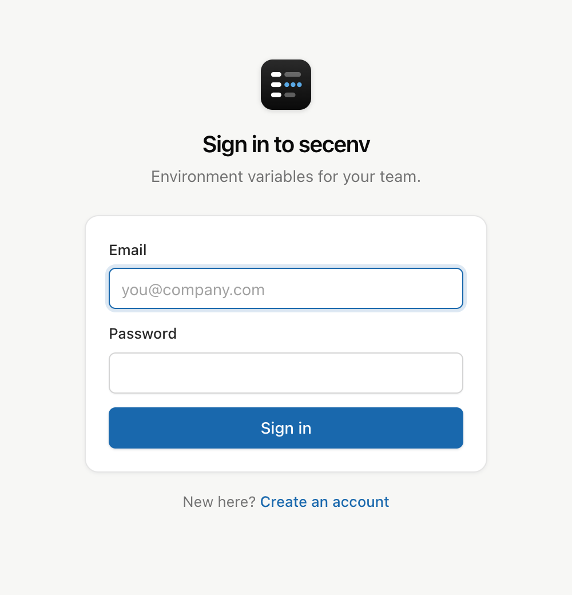

<p align="center">
  
</p>

<h1 align="center">secenv</h1>

<p align="center">
  <strong>Environment variables for your team, without the platform.</strong><br />
  Named env groups · encrypted at rest · a full audit trail · a TypeScript SDK · an MCP server for agents
</p>

<p align="center">
  <a href="#quick-start">Quick start</a> ·
  <a href="#load-env-in-your-app">SDK</a> ·
  <a href="#mcp-server">MCP</a> ·
  <a href="#configuration">Config</a> ·
  <a href="#deploy">Deploy</a>
</p>

<p align="center">
  
</p>

---

secenv is a much smaller take on tools like [Infisical](https://github.com/infisical/infisical). It has no projects, folders or approval workflows. You get **env groups**, like Render's, and a clear record of who changed what. It runs as one Bun process with one SQLite file and is set up from one config file.

## Why

- **Env groups, not a hierarchy.** Name a group `shared` or `backend-production`, put variables in it, and load one or more groups from a service. Later groups win, so `shared,backend-production` lets production override the shared defaults.
- **Every change and every look, on the record.** Each create, edit, rename and delete is logged with who made it, when, and from which IP. So is every time a value is viewed: revealed, copied, opened for editing, exported, seen in history, or loaded by the SDK or MCP. Expand an edit to see the value before and after.
- **Encrypted at rest.** Values are sealed with AES-256-GCM under a master key you hold. The database alone is useless.
- **Auth you choose.** Email/password, OIDC (Google, Okta, Entra ID, Auth0, Keycloak...), or both, set in `secenv.toml`.
- **Built for agents too.** An MCP server lets Claude and other clients read groups and, with a read/write token, change them. Those changes are labelled in the log.

<table>
  <tr>
    <td width="50%"></td>
    <td width="50%"></td>
  </tr>
  <tr>
    <td align="center"><sub><b>Env groups.</b> Masked values, inline editing, paste a whole <code>.env</code> to import.</sub></td>
    <td align="center"><sub><b>Activity.</b> Filter by change, group or person, and diff any edit.</sub></td>
  </tr>
</table>

## Quick start

Requires [Bun](https://bun.sh) 1.3+.

```sh
bun install
cp secenv.example.toml secenv.toml
bun run dev
```

Open **http://localhost:4400**. The first visit asks you to create the first account. After that, sign-up is closed unless you turn it on.

In development a master key is generated at `data/master.key`. In production, set `SECENV_MASTER_KEY`:

```sh
export SECENV_MASTER_KEY="$(openssl rand -base64 32)"
```

> [!WARNING]
> Back up the master key. Every value is encrypted with it, and without it they cannot be recovered.

## Load env in your app

```sh
bun add @secenv/sdk        # or npm i @secenv/sdk (Node 18+)
```

Create an API token under **API tokens**, then set `SECENV_URL` and `SECENV_TOKEN` where your app runs.

```ts
import { loadEnv } from "@secenv/sdk";

const env = await loadEnv({
  groups: ["shared", "backend-production"], // later groups win
  required: ["DATABASE_URL"],               // throws if missing; typed as string
});

env.DATABASE_URL; // string
```

Variables that are already set in `process.env` are kept by default, so a local override always beats the server. Pass `override: true` to change that.

<details>
<summary>All options</summary>

| Option | Default | Notes |
| --- | --- | --- |
| `groups` | `SECENV_GROUPS` | array or comma-separated string |
| `url` | `SECENV_URL` | |
| `token` | `SECENV_TOKEN` | |
| `override` | `false` | replace variables already in the target |
| `required` | `[]` | keys that must be present and non-empty |
| `target` | `process.env` | object to write into |
| `timeoutMs` | `10000` | per attempt |
| `retries` | `2` | on network errors and 5xx |

`fetchEnv(options)` returns the merged record without touching `process.env`. `createClient(options).getEnv(groups)` also returns group metadata.

</details>

### CLI

The SDK ships a small `secenv` binary:

```sh
secenv run -g shared,backend-production -- node server.js   # inject and run
secenv export -g backend-production > .env                  # --format dotenv | json | shell
```

### Plain HTTP

```sh
curl -H "Authorization: Bearer $SECENV_TOKEN" \
  "https://secenv.example.com/api/v1/env?groups=shared,backend-production&format=dotenv"
```

## MCP server

secenv serves MCP over Streamable HTTP at `/mcp`, authenticated with an API token. **Read-only** tokens get the read tools. **Read & write** tokens can also change variables, and those changes appear in the activity log tagged *via MCP*.

```sh
claude mcp add --transport http secenv https://secenv.example.com/mcp \
  --header "Authorization: Bearer se_..."
```

<details>
<summary>stdio clients</summary>

```json
{
  "mcpServers": {
    "secenv": {
      "command": "npx",
      "args": ["-y", "@secenv/sdk", "mcp"],
      "env": {
        "SECENV_URL": "https://secenv.example.com",
        "SECENV_TOKEN": "se_..."
      }
    }
  }
}
```

</details>

| Tool | Token | What it does |
| --- | --- | --- |
| `list_groups` | read | Groups the token can see, with variable counts |
| `get_variables` | read | Keys in a group. Values are masked unless `include_values: true` |
| `list_activity` | read | Recent changes. Never includes values |
| `set_variable` | write | Create or update a key |
| `delete_variable` | write | Remove a key. The old value stays in the log |
| `import_dotenv` | write | Bulk import `.env` text |
| `create_group` | write | Needs a token scoped to all groups |

## Audit log

| Event | Logged when | Details |
| --- | --- | --- |
| `var.create` / `var.update` / `var.delete` | a variable changes | old and new values (encrypted), rename |
| `var.view` | a value is shown to someone | one per key; source: reveal, copy, edit, export, history, mcp |
| `env.read` | the SDK, CLI or HTTP API loads a group | one per group, with the keys handed out |
| `group.*` / `token.*` | groups or tokens change | |

Every event stores the actor, the client IP and the user agent. The dashboard never receives a value without asking for it: the group page loads key names only, and values come from an audited endpoint. Click an IP in the activity log to see everything from that address.

If secenv runs behind a proxy, set `server.trusted_proxies` to the number of proxies so the real client IP is recorded. Only the entries those proxies added to `X-Forwarded-For` are trusted, so a client can't spoof its address.

## Configuration

Everything lives in `secenv.toml` (or the file named by `SECENV_CONFIG`; `.json` works too). Any string can reference an environment variable with `${NAME}`, so secrets stay out of the file. See [`secenv.example.toml`](./secenv.example.toml) for every option.

```toml
[server]
public_url = "https://secenv.example.com"
master_key = "${SECENV_MASTER_KEY}"

[auth]
allowed_email_domains = ["example.com"]   # applies to password and SSO

[auth.password]
enabled = true
allow_signup = false                      # the first account can always be created

[auth.oidc]
enabled = true
display_name = "Google"                   # "Continue with Google"
issuer = "https://accounts.google.com"
client_id = "${OIDC_CLIENT_ID}"
client_secret = "${OIDC_CLIENT_SECRET}"
```

Register `<public_url>/api/auth/oidc/callback` as the redirect URI with your provider. Sign-in uses the authorization code flow with PKCE, a state value bound to a cookie, and a nonce check. An SSO login whose email matches an existing account is linked to that account.

<p align="center">
  
</p>

## Deploy

A `Dockerfile` and a Render blueprint (`render.yaml`) are included.

1. Mount a persistent disk at `/app/data`. The SQLite database lives there.
2. Set `SECENV_MASTER_KEY` and `SECENV_PUBLIC_URL`, and `trusted_proxies = 1` (or `${SECENV_TRUSTED_PROXIES}`) so IPs in the audit log are real.
3. To use OIDC, edit `secenv.example.toml` before building, or point `SECENV_CONFIG` at a mounted file.

`PORT` is honoured, so Render, Fly and Railway work without extra config.

## Development

```sh
bun run dev          # server + UI with hot reload
bun test             # end-to-end: API, audit log, tokens, MCP, SDK, OIDC against a mock IdP
bun run typecheck
bun run build:sdk    # bundle @secenv/sdk to packages/sdk/dist
```

```
packages/server/src    Bun server: config, store (SQLite), auth + OIDC, REST API, MCP
packages/server/web    React dashboard: Overview, Env groups, Activity, API tokens, Members
packages/server/test   end-to-end tests
packages/sdk/src       @secenv/sdk and the secenv CLI
docs/                  icon and screenshots
```

<details>
<summary>REST API</summary>

**Session (cookie), used by the dashboard**

| Method | Path |
| --- | --- |
| `GET` `POST` | `/api/groups` |
| `GET` `PATCH` `DELETE` | `/api/groups/:id` (id or name) |
| `POST` | `/api/groups/:id/variables` |
| `PATCH` `DELETE` | `/api/groups/:id/variables/:variableId` |
| `POST` | `/api/groups/:id/import` |
| `GET` | `/api/activity?group=&action=&actor=&before=` |
| `GET` | `/api/activity/:id/values` |
| `GET` | `/api/stats` |
| `GET` `POST` | `/api/tokens` |
| `DELETE` | `/api/tokens/:id` |

**Token (`Authorization: Bearer se_...`)**

| Method | Path |
| --- | --- |
| `GET` | `/api/v1/env?groups=a,b[&format=dotenv]` |
| `POST` | `/mcp` |

</details>

## What secenv doesn't do

It's deliberately small. Everyone who can sign in can edit every group: there are no roles, approval flows, secret rotation or per-environment branching inside a group. If you need those, use Infisical.
